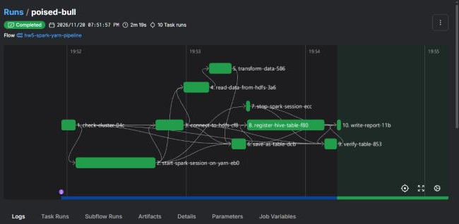

# ДЗ5. Prefect: Spark на YARN → HDFS → преобразования → таблица

Процесс обработки данных оформлен как поток (flow) **Prefect**. Поток запускает сессию Spark под управлением YARN кластера из [ДЗ2](../hw2/README.md), подключается к HDFS из [ДЗ1](../hw1/README.md), читает данные, ранее загруженные на HDFS в [ДЗ3](../hw3/README.md), преобразует их и сохраняет результат как таблицу. Таблица сохраняется методом Spark `saveAsTable` и дополнительно регистрируется как постоянная внешняя таблица Hive `hw5_lab.customer_summary`, которую можно читать через Beeline после завершения Spark.

Нужен весь репозиторий: скрипты используют общий `inventory.json`, Spark из [ДЗ4](../hw4/README.md) и функции Hive из ДЗ3. Результаты прогонов на стенде — в [VALIDATION.md](../VALIDATION.md#дз5--prefect-и-spark-на-yarn-20112026), машинный отчёт — в [checks/prefect-runtime.json](../checks/prefect-runtime.json).

## Как выполнены требования

Каждый шаг задания — отдельная задача (task) Prefect внутри потока `hw5-spark-yarn-pipeline` ([flow.py](flow.py)). Prefect фиксирует состояние, время и журнал каждой задачи.

| Шаг задания | Задача Prefect | Что делает |
|---|---|---|
| — | `1. check-cluster` | HDFS не в safe mode, `fs.defaultFS` совпадает с inventory, ResourceManager в состоянии `STARTED`, есть активные NodeManager, на HDFS есть входные CSV |
| 1. Сессия Spark под управлением YARN | `2. start-spark-session-on-yarn` | `SparkSession.builder.master("yarn")`, режим `client`: драйвер на edge, ApplicationMaster и два исполнителя в контейнерах YARN; проверяется `master == "yarn"` и настоящий `application_...` |
| 2. Подключение к HDFS | `3. connect-to-hdfs` | Через Hadoop `FileSystem` той же сессии Spark: проверка `fs.defaultFS`, ёмкости кластера, списка входных файлов; создание собственного каталога запуска `/user/team/hw5/runs/run-<id>` |
| 3. Чтение данных с HDFS | `4. read-data-from-hdfs` | `spark.read.csv` из `hdfs://.../user/hive/warehouse/hw3/hw3_lab.db/sales/dt=*/*.csv`, дата берётся из имени каталога партиции |
| 4. Трансформации | `5. transform-data` | Проверка формата строк, приведение типов (`string` → `int`, `decimal(10,2)`, `date`), фильтрация, агрегация по покупателю (`count`, `countDistinct`, `min`, `max`, `sum`, `avg`), вычисляемый столбец `segment` |
| 5. Сохранение как таблицы | `6. save-as-table` | `saveAsTable("hw5_spark.customer_summary")` в формате Parquet в каталог запуска; таблица и файлы перечитываются и сверяются |
| — | `7. stop-spark-session` | `spark.stop()`; вызывается и при ошибке на шагах 3–6 |
| 5. Постоянная таблица | `8. register-hive-table` | Через существующий HiveServer2: внешняя таблица `hw5_lab.customer_summary` (Parquet) указывает на данные текущего запуска |
| — | `9. verify-table` | Отдельный клиент Beeline читает таблицу после остановки Spark; ResourceManager подтверждает `FINISHED / SUCCEEDED` |
| — | `10. write-report` | JSON-отчёт о запуске |

## Архитектура и версии

```text
edge: python hw5/flow.py  ── Prefect flow (+ временный или выделенный сервер Prefect)
        │
        ├─ SparkSession (driver на edge) ── YARN ResourceManager ── AM + 2 executors
        │                                                       │
        │                                   чтение CSV ДЗ3 ─────┤
        │                                   запись Parquet ДЗ5 ─┘   (HDFS)
        │
        └─ Beeline ── HiveServer2 (worker2) ── Metastore (master) ── PostgreSQL
                         └── hw5_lab.customer_summary → Parquet текущего запуска
```

- **Prefect 3.9.2** — в отдельном virtualenv на edge: `/home/team/teachbase-prefect/venv`. Версия закреплена в [requirements.txt](requirements.txt), версии всех зависимостей — в [constraints.txt](constraints.txt) (сняты с проверенного стенда).
- **Spark 3.5.9** — уже установлен в ДЗ4 (`/home/team/teachbase-spark`). PySpark не ставится через `pip`: используется `python/` из дистрибутива Spark, поэтому версии драйвера и JVM-части гарантированно совпадают. Это настраивает `PYTHONPATH` в `course-env.sh`.
- Python драйвера (virtualenv) и исполнителей (`/usr/bin/python3`) — один и тот же Python 3.12; PySpark требует совпадения минорной версии.
- Hadoop 3.4.2, Hive 4.0.0-alpha-2, Java 11 — без изменений.

Spark 3.5 не поддерживает клиент Metastore Hive 4 alpha (см. ДЗ4), поэтому сессия использует каталог `in-memory`, а постоянные метаданные создаются через Beeline. Таблица Spark `hw5_spark.customer_summary` существует в пределах сессии; таблица Hive `hw5_lab.customer_summary` — постоянная и указывает на те же Parquet-файлы.

Без переменной `PREFECT_API_URL` Prefect на время запуска поднимает **временный** локальный сервер (SQLite в `PREFECT_HOME=/home/team/teachbase-prefect/home`); история запусков сохраняется там же. Для просмотра в веб-интерфейсе можно запустить выделенный сервер — см. [Веб-интерфейс Prefect](#веб-интерфейс-prefect). Prefect Cloud и учётные записи не нужны.

## Данные и ожидаемый результат

Источник — набор из ДЗ3 на HDFS, без повторной загрузки:

```text
/user/hive/warehouse/hw3/hw3_lab.db/sales/
  dt=2026-10-01/sales-2026-10-01.csv   (sale_id,customer_id,amount)
  dt=2026-10-02/sales-2026-10-02.csv
```

Преобразования:

1. проверка формата всех полей (при некорректной строке поток падает, а не теряет её молча);
2. приведение типов: `sale_id`, `customer_id` → `INT`, `amount` → `DECIMAL(10,2)`, дата из пути партиции → `DATE`;
3. фильтрация: только покупки с положительной суммой;
4. агрегация по покупателю: число покупок, число дней с покупками, первая и последняя дата, сумма, средний и максимальный чек;
5. вычисляемый столбец `segment`: `high`, если сумма покупок не меньше 200.00, иначе `regular`.

Результат Spark дополнительно сверяется с расчётом на чистом Python ([pipeline.py](pipeline.py)) и с контрольными суммами: число заказов и общая сумма не должны измениться при агрегации.

| customer_id | order_count | active_days | first_purchase | last_purchase | total_amount | average_amount | max_amount | segment |
|---:|---:|---:|---|---|---:|---:|---:|---|
| 101 | 2 | 1 | 2026-10-01 | 2026-10-01 | 149.50 | 74.75 | 100.00 | regular |
| 102 | 2 | 2 | 2026-10-01 | 2026-10-02 | 370.50 | 185.25 | 250.50 | high |
| 103 | 1 | 1 | 2026-10-02 | 2026-10-02 | 80.00 | 80.00 | 80.00 | regular |
| 104 | 1 | 1 | 2026-10-02 | 2026-10-02 | 300.00 | 300.00 | 300.00 | high |

Итого: **4 строки, 6 исходных заказов, сумма 900.00**.

## Автоматический вариант

Команды выполнять **на edge** из корня репозитория обычным пользователем Hadoop (в примере `team`). В локальном `inventory.json` должны быть реальные адреса узлов, у `worker1` — `local: true`. Должны работать HDFS, YARN, Metastore и HiveServer2, должны быть установлены Spark из ДЗ4 и загружены данные ДЗ3:

```bash
source /home/team/teachbase-spark/course-env.sh
hdfs dfsadmin -safemode get
yarn node -list
hdfs dfs -ls -R /user/hive/warehouse/hw3/hw3_lab.db/sales
python3 hw3/deploy.py --inventory inventory.json --action status --execute
```

Если это новый стенд, сначала пройти ДЗ1–ДЗ4.

### 1. Предпросмотр

Ничего не устанавливает и не обращается к кластеру: сохраняет `course-env.sh` в `generated-prefect/` и печатает DDL таблицы Hive.

```bash
python3 hw5/deploy.py --inventory inventory.json
```

### 2. Установка Prefect

```bash
python3 hw5/deploy.py --inventory inventory.json --execute
```

Скрипт создаёт каталог `/home/team/teachbase-prefect` с маркером принадлежности, virtualenv, ставит `prefect==3.9.2` с [constraints.txt](constraints.txt), пишет `course-env.sh` и проверяет, что в одном интерпретаторе импортируются Prefect 3.9.2 и PySpark 3.5.9. Файлы Hadoop, Spark и Hive не меняются.

### 3. Запуск потока

```bash
source /home/team/teachbase-prefect/course-env.sh
python hw5/flow.py --inventory inventory.json
```

Поток выполняет задачи 1–10, в конце печатает краткий итог и пишет отчёт в `checks/prefect-runtime.json` (другой файл — через `--report`). Локальная блокировка `/home/team/teachbase-prefect/.run.lock` не даёт запустить два потока одновременно.

Каждый запуск пишет данные в новый каталог `/user/team/hw5/runs/run-<id потока Prefect>/data`, а таблица Hive переключается на него командой `ALTER TABLE ... SET LOCATION`. Поэтому повторный запуск даёт те же 4 строки, а не дубликаты; результаты прошлых запусков остаются на HDFS, исходные данные ДЗ3 не меняются.

### 4. История запусков

```bash
source /home/team/teachbase-prefect/course-env.sh
prefect flow-run ls
prefect flow-run logs <ID запуска>
```

Ожидаются запуски потока `hw5-spark-yarn-pipeline` в состоянии `COMPLETED`; в журнале — все десять задач в состоянии `Completed`.

### Веб-интерфейс Prefect

Необязательно. Запустить выделенный сервер на edge (слушает только localhost) и направить поток в него:

```bash
source /home/team/teachbase-prefect/course-env.sh
nohup prefect server start --host 127.0.0.1 --port 4200 \
  > /home/team/teachbase-prefect/server.log 2>&1 &
export PREFECT_API_URL=http://127.0.0.1:4200/api
python hw5/flow.py --inventory inventory.json
```

Со своего компьютера открыть туннель и перейти на `http://localhost:4200` — там видны запуски потока, граф задач и журналы (включая запуски, сделанные с временным сервером: база та же).

```bash
ssh -N -L 4200:127.0.0.1:4200 team@<внешний адрес edge>
```

Остановить сервер: `pkill -f "prefect server start"`.



## Ручной вариант

Ниже — те же действия без `deploy.py`. Сам поток — [flow.py](flow.py); его задачи описаны в таблице выше.

### 1. Окружение Prefect

```bash
set -euo pipefail
export PREFECT_BASE=/home/team/teachbase-prefect
export SPARK_HOME=/home/team/teachbase-spark/spark-3.5.9-bin-hadoop3
mkdir -p "$PREFECT_BASE"/{home,evidence}
printf '%s\n' hadoop-homework-hw5-v1 > "$PREFECT_BASE/.hw5-owner"
/usr/bin/python3 -m venv "$PREFECT_BASE/venv"
"$PREFECT_BASE/venv/bin/python" -m pip install -r hw5/requirements.txt -c hw5/constraints.txt

cat > "$PREFECT_BASE/course-env.sh" <<EOF
#!/usr/bin/env bash
source /home/team/teachbase-spark/course-env.sh || return
source $PREFECT_BASE/venv/bin/activate || return
export PREFECT_HOME=$PREFECT_BASE/home
export PREFECT_SERVER_ANALYTICS_ENABLED=false
export PREFECT_SERVER_EPHEMERAL_STARTUP_TIMEOUT_SECONDS=120
export PYTHONPATH=$SPARK_HOME/python:$SPARK_HOME/python/lib/py4j-0.10.9.7-src.zip\${PYTHONPATH:+:\$PYTHONPATH}
EOF
source "$PREFECT_BASE/course-env.sh"
python -c 'import prefect, pyspark; print(prefect.__version__, pyspark.__version__)'
```

Ожидается `3.9.2 3.5.9`. Тайм-аут запуска временного сервера увеличен до 120 секунд: на ВМ с 2 vCPU стандартных 20 секунд может не хватить.

### 2. Запуск потока

```bash
source /home/team/teachbase-prefect/course-env.sh
python hw5/flow.py --inventory inventory.json
```

Параметры Spark заданы в задаче `start-spark-session-on-yarn` и в `spark-defaults.conf` из ДЗ4: `master=yarn`, `deployMode=client`, драйвер 512 MiB на внутреннем адресе edge, 2 исполнителя по 1 ядру и 512 MiB + 384 MiB накладных расходов, ApplicationMaster 512 MiB + 384 MiB. Каждый контейнер YARN округляется до 1024 MiB, три контейнера помещаются на трёх NodeManager по 1536 MiB.

### 3. Проверка результата вручную

Найти каталог и YARN-приложение последнего запуска в отчёте:

```bash
REPORT=checks/prefect-runtime.json
APP_ID="$(python3 -c 'import json,sys; print(json.load(open(sys.argv[1]))["spark"]["application_id"])' "$REPORT")"
OUTPUT="$(python3 -c 'import json,sys; print(json.load(open(sys.argv[1]))["hdfs"]["output_path"])' "$REPORT")"
yarn application -status "$APP_ID"
hdfs dfs -ls "$OUTPUT"
```

Ожидаются `Application-Type: SPARK`, `State: FINISHED`, `Final-State: SUCCEEDED`, файл `_SUCCESS` и Parquet-файл.

Прочитать таблицу отдельным клиентом Hive (адрес HiveServer2 — внутренний IP `worker2` из inventory; `10.10.0.12` — пример):

```bash
source /home/team/teachbase-hive/course-env.sh
beeline -u "jdbc:hive2://10.10.0.12:10000/default" -n team -e "
DESCRIBE FORMATTED hw5_lab.customer_summary;
SELECT * FROM hw5_lab.customer_summary ORDER BY customer_id;
SELECT COUNT(*) AS customers, SUM(order_count) AS orders, SUM(total_amount) AS total
FROM hw5_lab.customer_summary;
SELECT segment, COUNT(*) AS customers, SUM(total_amount) AS total
FROM hw5_lab.customer_summary GROUP BY segment ORDER BY segment;
"
```

Ожидаются тип `EXTERNAL_TABLE`, `ParquetHiveSerDe`, `Location` = каталог текущего запуска; 4 строки из таблицы выше; итог `4`, `6`, `900.00`; по сегментам `high` — 2 покупателя на 670.50, `regular` — 2 покупателя на 229.50.

DDL, который выполняет задача `register-hive-table` (первый запуск создаёт базу и таблицу, каждый запуск переключает расположение):

```sql
CREATE DATABASE IF NOT EXISTS hw5_lab
LOCATION 'hdfs://10.10.0.10:9000/user/team/hw5/database';
CREATE EXTERNAL TABLE IF NOT EXISTS hw5_lab.customer_summary (
  customer_id INT, order_count BIGINT, active_days BIGINT,
  first_purchase DATE, last_purchase DATE,
  total_amount DECIMAL(20,2), average_amount DECIMAL(20,2), max_amount DECIMAL(10,2),
  segment STRING
)
STORED AS PARQUET
LOCATION 'hdfs://10.10.0.10:9000/user/team/hw5/table'
TBLPROPERTIES ('hw5.owner'='hadoop-homework-hw5-v1', 'transactional'='false');
ALTER TABLE hw5_lab.customer_summary
  SET LOCATION 'hdfs://10.10.0.10:9000/user/team/hw5/runs/run-<id>/data';
```

Перед `SET LOCATION` поток проверяет маркер `hw5.owner`, схему, тип `EXTERNAL_TABLE`, формат Parquet и то, что расположение относится к `/user/team/hw5`. Чужая таблица с тем же именем не изменяется.

При диагностике:

```bash
yarn logs -applicationId "$APP_ID"
hdfs fsck /user/team/hw5 -files -blocks -locations
prefect flow-run logs <ID запуска>
```

## Проверка скриптов без кластера

```bash
python3 -m unittest tests.test_prefect_flow -v
python3 -m compileall -q hw5
python3 hw5/deploy.py --inventory inventory.example.json
```

Тесты не требуют Prefect и Spark: они проверяют настройки, расчёт на чистом Python, контрольные суммы, пути запусков и проверки метаданных Hive.

## Файлы решения

- [flow.py](flow.py) — поток Prefect: задачи 1–10, SparkSession на YARN, чтение, преобразования, `saveAsTable`, регистрация и проверка таблицы.
- [pipeline.py](pipeline.py) — функции без сторонних библиотек: схема результата, эталонный расчёт, DDL и проверки Hive.
- [config.py](config.py) — настройки из `inventory.json` и `course-env.sh`.
- [deploy.py](deploy.py) — установка Prefect в virtualenv на edge.
- [requirements.txt](requirements.txt), [constraints.txt](constraints.txt) — закреплённые версии.

## Первичные источники

- [Prefect 3: flows](https://docs.prefect.io/v3/concepts/flows) и [tasks](https://docs.prefect.io/v3/concepts/tasks).
- [Prefect 3: кэширование задач и `NO_CACHE`](https://docs.prefect.io/v3/concepts/caching), [результаты задач](https://docs.prefect.io/v3/advanced/results).
- [Prefect 3: сервер и временный сервер](https://docs.prefect.io/v3/concepts/server), [настройки](https://docs.prefect.io/v3/api-ref/settings-ref).
- [Spark 3.5.9: запуск на YARN](https://spark.apache.org/docs/3.5.9/running-on-yarn.html), [SparkSession.builder.master](https://spark.apache.org/docs/3.5.9/api/python/reference/pyspark.sql/api/pyspark.sql.SparkSession.builder.master.html).
- [DataFrameWriter.saveAsTable](https://spark.apache.org/docs/3.5.9/api/python/reference/pyspark.sql/api/pyspark.sql.DataFrameWriter.saveAsTable.html), [Spark SQL: Parquet](https://spark.apache.org/docs/3.5.9/sql-data-sources-parquet.html).
- [Hive: внешние таблицы и ALTER TABLE SET LOCATION](https://hive.apache.org/docs/latest/language/languagemanual-ddl/).
